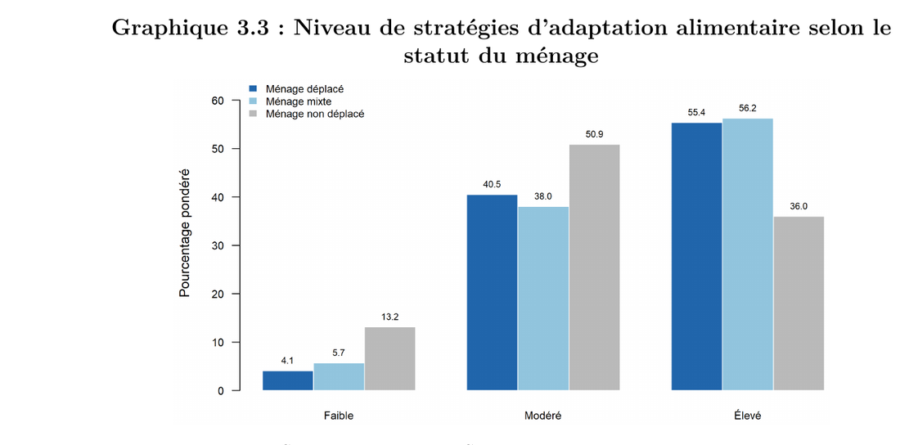
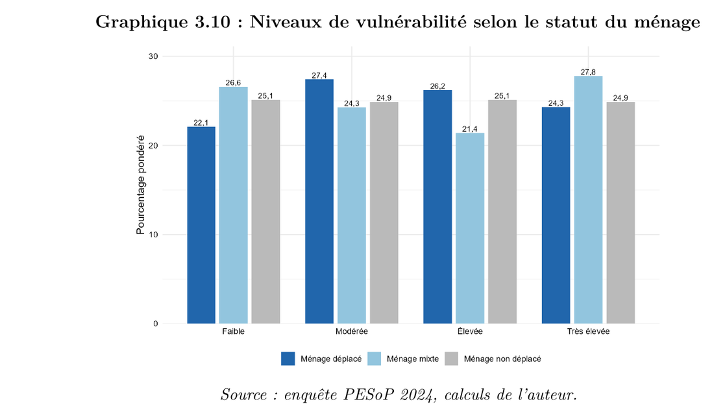

[← Back to experience](/#experience){.pf-back}

```{=html}
<ul class="pf-facts">
  <li><span>Department</span><b>Demographic, socio-economic and environmental statistics</b></li>
  <li><span>Data</span><b>PESoP 2024 survey: 2,686 households in 5 municipalities</b></li>
  <li><span>Result</span><b>Thesis defended on 29 June 2026, graded 17.20/20</b></li>
</ul>
<p class="pf-docrow">
  <a class="pf-more pf-more--solid" href="/assets/docs/experience/thesis-ins-2026.pdf">Read the thesis (PDF, in French)</a>
  <a class="pf-more" href="/assets/docs/experience/ins-internship-certificate.pdf">Internship certificate</a>
</p>
```

## The question

In the West region of Cameroon, forced displacement has lasted for years. Displaced families live in host municipalities, next to families who never moved. Aid is often targeted at displaced households only.

My thesis asked: **how vulnerable are the households of these host municipalities, in which ways, and what explains it?** It covers all households of the five most affected municipalities, displaced or not.

## What I did

- Prepared and described the data of the PESoP 2024 survey (a profiling survey by UNHCR, GIZ, JIPS, INS and BUCREP), with survey weights.
- Built a **synthetic vulnerability index** with a Multiple Correspondence Analysis (MCA), then cut it into four ordered levels.
- Drew a **typology of five household profiles** with a Hierarchical Cluster Analysis (HCA, Ward's method).
- Identified the **drivers of vulnerability** with an ordered logit model estimated under the survey design.
- Wrote the thesis and defended it in front of a jury.

Tools: R and Python.

## Main results

**1. Food is where displaced households are worse off.** 55.4% of displaced households use a high level of food coping strategies, against 36.0% of non-displaced households.

{.pf-shot}

**2. But overall vulnerability is shared.** Once all deprivations are combined in the index, the level of vulnerability is not significantly different between displaced and non-displaced households. Displacement changes the *form* of vulnerability more than its *intensity*.

{.pf-shot}

**3. Education protects the most.** When the head of household has higher education, the odds of being in a more vulnerable level fall by 93%.

**4. Missing civil documents increase the risk.** Weak documentation (birth certificates, identity cards) raises these odds by 75%. Marital status and the municipality of residence also matter. The duration of displacement has no significant effect.

## What it means, in simple words

- Help should go to the households that are vulnerable, not only to those that are displaced. Many host families are in the same situation.
- Two levers stand out: keeping children in school and training adults, and helping families get their civil documents. The survey shows that the main obstacle to documents is not the cost: people do not know the procedure.
- Needs differ a lot from one municipality to another, so action should be local.

## Limits

The index is relative: it ranks households against each other, it does not measure deprivation in absolute terms. The data is a single snapshot in time, so the results are associations, not proven causes. The results hold for these five municipalities only.
