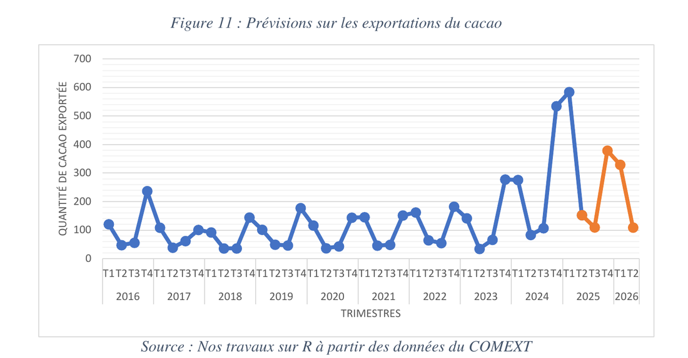

[← Back to experience](/#experience){.pf-back}

```{=html}
<ul class="pf-facts">
  <li><span>Division</span><b>Forecasting Division, real economy monitoring unit</b></li>
  <li><span>Data</span><b>Cocoa production and exports, 2015 – 2025</b></li>
  <li><span>Output</span><b>Internship report, defended on 27 February 2026</b></li>
</ul>
<p class="pf-docrow">
  <a class="pf-more pf-more--solid" href="/assets/docs/experience/minfi-internship-report-2025.pdf">Read the report (PDF, in French)</a>
  <a class="pf-more" href="/assets/docs/experience/minfi-internship-certificate.pdf">Internship certificate</a>
</p>
```

## Context

Cocoa is a pillar of Cameroon's export agriculture and a source of public revenue. The Forecasting Division follows the real economy and prepares, among other things, the annual report on the economy (RASIPEFIN) and quarterly economic notes.

## What I did

- Read and reviewed the quarterly economic note (Q4 2024) and the 2024 edition of the RASIPEFIN, to suggest improvements in form and content.
- Helped prepare the letters sent by the ministry to other ministries and partners (World Bank, IMF, BEAC) for the annual data collection, and took part in collecting data from a public company.
- Built a dashboard of agricultural indicators, replacing calculations that were redone by hand in Excel.
- Carried out my own study: **the evolution of cocoa production and exports in Cameroon between 2015 and 2025**.

Tools: Excel for the descriptive analysis, R for the forecasts.

## The study

**Data.** The RASIPEFIN and the ministry's foreign trade database.

**Method.** A descriptive analysis of production, exports and prices, then a multiplicative decomposition of the quarterly export series (trend × seasonality) to forecast the next quarters.

**Main findings.**

- Production moved around 310,000 tonnes per year over the period.
- Exported volumes fell from about 265,000 tonnes in 2015 to about 180,000 tonnes in 2023, and are still mostly raw beans.
- Prices were very volatile, from 1,160 FCFA/kg in 2017 to almost 1,780 FCFA/kg in 2023, with no significant link to produced or exported volumes.
- Exports are strongly seasonal: a peak in the fourth quarter (main harvest season) and a low point in the second quarter. The forecast gave a peak of about 379 billion FCFA for the fourth quarter of 2025.

{.pf-shot}

## What it means, in simple words

Cocoa sales abroad follow the farming calendar. Because this pattern repeats every year, the ministry can plan for it: port and customs logistics during the peak, and budget forecasts that expect lower revenue in the second quarter. The study also recommends processing more cocoa locally, since most exports are still raw beans.

## Limits

The quarterly series is short (2016–2025), and the method assumes a stable seasonality, while cocoa is exposed to weather and world price shocks.
