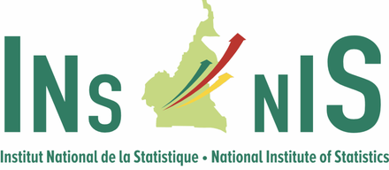
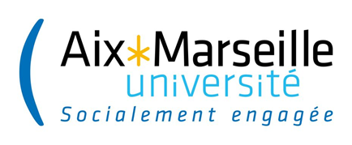
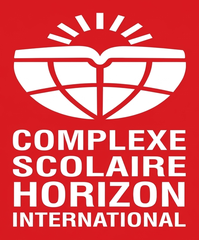

```{=html}
<header class="pf-hero">
  <div class="pf-wrap pf-hero__grid">
    <div>
      <h1>Joris<br>NITIEMA</h1>
      <p class="pf-hero__role">Statistician, Master's student in Econometrics-Statistics at Aix-Marseille University</p>
      <p class="pf-hero__pitch">I turn survey and administrative data into indicators, models and dashboards that people can use to decide.</p>
      <p class="pf-hero__seek">I am looking for a 3 to 4 month internship, May to August 2027, in data science, econometrics or applied statistics.</p>
      <a class="pf-btn pf-btn--solid" href="#experience">See my experience</a>
      <a class="pf-btn pf-btn--line" href="cv.html">Download my CV</a>
    </div>
    <!-- To use the round version instead, replace this block with:
          -->
    <figure class="pf-photo"></figure>
  </div>
</header>

<section class="pf-section" id="path">
  <div class="pf-wrap">
    <h2>My path</h2>
    <p class="pf-story">I have always loved mathematics and computing. Three years ago, this led me to statistics at ISSEA in Yaoundé, the regional statistics school of the CEMAC countries, which I entered through a competitive exam. There, I learned <mark class="pf-hl">the mathematics behind statistics</mark> (probability, inference, linear algebra, optimisation), how to <mark class="pf-hl">apply it to real data</mark> through econometrics, data analysis, survey sampling and time series, and how to do it <mark class="pf-hl">with the right tools</mark>: Excel, R, Python, Stata and SQL. To go further, I joined the Master's in Econometrics-Statistics at Aix-Marseille University. Now I want to put these skills into practice again, in a new team, through an internship.</p>
  </div>
</section>

<section class="pf-section" id="experience">
  <div class="pf-wrap">
    <h2>Experience</h2>
    <p class="pf-lede">From collecting survey data in the field to building indicators for a ministry.</p>
    <div class="pf-grid2">
      <article class="pf-card pf-xp-card">
        <div class="pf-card__head"><div><span class="pf-tag">Internship</span><div class="pf-when">Mar – Jun 2026</div></div></div>
        <h3>Assistant Data Analyst – Household Surveys</h3>
        <div class="pf-org">National Institute of Statistics (INS) · Yaoundé, Cameroon</div>
        <p>Measured the vulnerability of 2,686 households hosting displaced people, from a national survey. Thesis graded 17.20/20.</p>
        <div class="pf-card__foot"><a class="pf-more" href="experience/ins.html">Details <svg class="pf-ico" viewBox="0 0 24 24" aria-hidden="true" fill="none" stroke="currentColor" stroke-width="1.8" stroke-linecap="round" stroke-linejoin="round"><path d="M5 12h14"/><path d="m13 6 6 6-6 6"/></svg></a></div>
      </article>
      <article class="pf-card pf-xp-card">
        <div class="pf-card__head"><div><span class="pf-tag">Internship</span><div class="pf-when">Jul – Sep 2025</div></div></div>
        <h3>Assistant Economic Analyst – Forecasting</h3>
        <div class="pf-org">Ministry of Finance (MINFI) · Yaoundé, Cameroon</div>
        <p>Analysed and forecast cocoa production and exports, and built a dashboard of agricultural indicators.</p>
        <div class="pf-card__foot"><a class="pf-more" href="experience/minfi.html">Details <svg class="pf-ico" viewBox="0 0 24 24" aria-hidden="true" fill="none" stroke="currentColor" stroke-width="1.8" stroke-linecap="round" stroke-linejoin="round"><path d="M5 12h14"/><path d="m13 6 6 6-6 6"/></svg></a></div>
      </article>
      <article class="pf-card pf-xp-card">
        <div class="pf-card__head"><div><span class="pf-tag pf-tag--field">Field survey</span><div class="pf-when">May 2025</div></div></div>
        <h3>Survey Field Supervisor</h3>
        <div class="pf-org">ISSEA · Yaoundé, Cameroon</div>
        <p>Supervised interviewers, checked data consistency and validated the collected data.</p>
        <div class="pf-card__foot"><a class="pf-more" href="experience/issea-surveys.html#supervisor">Details <svg class="pf-ico" viewBox="0 0 24 24" aria-hidden="true" fill="none" stroke="currentColor" stroke-width="1.8" stroke-linecap="round" stroke-linejoin="round"><path d="M5 12h14"/><path d="m13 6 6 6-6 6"/></svg></a></div>
      </article>
      <article class="pf-card pf-xp-card">
        <div class="pf-card__head"><div><span class="pf-tag pf-tag--field">Field survey</span><div class="pf-when">May 2024</div></div></div>
        <h3>Survey Enumerator</h3>
        <div class="pf-org">ISSEA · Yaoundé, Cameroon</div>
        <p>Face-to-face interviews for a household survey on urban safety in Yaoundé.</p>
        <div class="pf-card__foot"><a class="pf-more" href="experience/issea-surveys.html#interviewer">Details <svg class="pf-ico" viewBox="0 0 24 24" aria-hidden="true" fill="none" stroke="currentColor" stroke-width="1.8" stroke-linecap="round" stroke-linejoin="round"><path d="M5 12h14"/><path d="m13 6 6 6-6 6"/></svg></a></div>
      </article>
    </div>
  </div>
</section>

<section class="pf-section" id="work">
  <div class="pf-wrap">
    <h2>Projects</h2>
    <p class="pf-lede">Applications built on real data, that you can open and use.</p>
    <div class="pf-grid2">
      <article class="pf-card pf-pj-card pf-pj-card--lead">
        <div>
          <span class="pf-tag">Dashboard · Data mining</span>
          <h3>Queue-reduction dashboard</h3>
          <p>An R Shiny dashboard for a bank: where waiting time comes from, how it changes during the day, and a scenario simulator to test more counters or a different organisation.</p>
          <ul class="pf-tools"><li>R</li><li>Shiny</li><li>dplyr</li><li>ggplot2</li></ul>
          <div class="pf-card__foot"><a class="pf-more pf-more--solid" href="https://joris-nitiema.shinyapps.io/dashboard-files-attente/"><svg class="pf-ico" viewBox="0 0 24 24" aria-hidden="true" fill="none" stroke="currentColor" stroke-width="1.8" stroke-linecap="round" stroke-linejoin="round"><path d="M14 4h6v6"/><path d="M20 4 10 14"/><path d="M18 14v5a1 1 0 0 1-1 1H5a1 1 0 0 1-1-1V7a1 1 0 0 1 1-1h5"/></svg> Open the app</a><a class="pf-more" href="projects/queue-dashboard/">Details <svg class="pf-ico" viewBox="0 0 24 24" aria-hidden="true" fill="none" stroke="currentColor" stroke-width="1.8" stroke-linecap="round" stroke-linejoin="round"><path d="M5 12h14"/><path d="m13 6 6 6-6 6"/></svg></a></div>
        </div>
        <div class="pf-figure"><b>255,000</b><span>real bank operations analysed</span></div>
      </article>
      <article class="pf-card pf-pj-card">
        <span class="pf-tag">Web app · Team of 3</span>
        <h3>EcoTrack Local</h3>
        <p>Track and compare prices by neighbourhood in Yaoundé, with an interactive map, automatic detection of unusual prices and CSV export.</p>
        <ul class="pf-tools"><li>Python</li><li>Django</li><li>pandas</li></ul>
        <div class="pf-card__foot"><a class="pf-more pf-more--solid" href="https://nitiemajoris.pythonanywhere.com"><svg class="pf-ico" viewBox="0 0 24 24" aria-hidden="true" fill="none" stroke="currentColor" stroke-width="1.8" stroke-linecap="round" stroke-linejoin="round"><path d="M14 4h6v6"/><path d="M20 4 10 14"/><path d="M18 14v5a1 1 0 0 1-1 1H5a1 1 0 0 1-1-1V7a1 1 0 0 1 1-1h5"/></svg> Open the app</a><a class="pf-more" href="projects/ecotrack/">Details <svg class="pf-ico" viewBox="0 0 24 24" aria-hidden="true" fill="none" stroke="currentColor" stroke-width="1.8" stroke-linecap="round" stroke-linejoin="round"><path d="M5 12h14"/><path d="m13 6 6 6-6 6"/></svg></a></div>
      </article>
      <article class="pf-card pf-pj-card">
        <span class="pf-tag">Learning app</span>
        <h3>Vocab Combo Trainer</h3>
        <p>A Shiny app I built to practise English–French vocabulary, with game modes, progress tracking and AI-assisted correction.</p>
        <ul class="pf-tools"><li>R</li><li>Shiny</li></ul>
        <div class="pf-card__foot"><a class="pf-more pf-more--solid" href="https://joris-nitiema.shinyapps.io/application/"><svg class="pf-ico" viewBox="0 0 24 24" aria-hidden="true" fill="none" stroke="currentColor" stroke-width="1.8" stroke-linecap="round" stroke-linejoin="round"><path d="M14 4h6v6"/><path d="M20 4 10 14"/><path d="M18 14v5a1 1 0 0 1-1 1H5a1 1 0 0 1-1-1V7a1 1 0 0 1 1-1h5"/></svg> Open the app</a><a class="pf-more" href="projects/vocab-trainer/">Details <svg class="pf-ico" viewBox="0 0 24 24" aria-hidden="true" fill="none" stroke="currentColor" stroke-width="1.8" stroke-linecap="round" stroke-linejoin="round"><path d="M5 12h14"/><path d="m13 6 6 6-6 6"/></svg></a></div>
      </article>
    </div>
  </div>
</section>

<section class="pf-section" id="education">
  <div class="pf-wrap">
    <h2>Education</h2>
    <div class="pf-stack">
      <article class="pf-card pf-ed-card">
        <div class="pf-card__head"><div><span class="pf-tag">In progress · since 2026</span><h3>Master in Econometrics-Statistics</h3><div class="pf-org">Aix-Marseille School of Economics (AMSE) · Marseille, France</div></div></div>
        <p>First year of the Master's, taught entirely in English: econometrics, statistics and data science.</p>
        
        
      </article>
      <article class="pf-card pf-ed-card">
        <div class="pf-card__head"><div><span class="pf-tag">Obtained · 2023 – 2026</span><h3>Analyst Statistician diploma, data science track</h3><div class="pf-org">ISSEA · Yaoundé, Cameroon</div></div></div>
        <p>Admitted through the competitive entrance exam shared by ENSAE Dakar, ENSEA Abidjan and ISSEA. Probability, inference, econometrics, survey sampling, data analysis and machine learning.</p>
        <ul class="pf-grades"><li><span>Year 1</span><b>15.30</b><small>3rd of 28</small></li><li><span>Year 2</span><b>15.51</b><small>3rd of 28</small></li><li><span>Year 3</span><b>16.38</b><small>1st of 19</small></li><li><span>Thesis</span><b>17.20</b></li></ul>
        <div class="pf-card__foot"><a class="pf-more pf-soon" href="/assets/diplomas/issea-diploma.pdf"><svg class="pf-ico" viewBox="0 0 24 24" aria-hidden="true" fill="none" stroke="currentColor" stroke-width="1.8" stroke-linecap="round" stroke-linejoin="round"><path d="M14 3H7a2 2 0 0 0-2 2v14a2 2 0 0 0 2 2h10a2 2 0 0 0 2-2V8z"/><path d="M14 3v5h5"/><path d="M9 13h6"/><path d="M9 17h4"/></svg> View diploma</a></div>
      </article>
      <article class="pf-card pf-ed-card">
        <div class="pf-card__head"><div><span class="pf-tag">Obtained · 2023</span><h3>Baccalauréat, mathematics and physics (série C)</h3><div class="pf-org">Collège Horizon International · Ouagadougou, Burkina Faso</div></div></div>
        <p>Top of the class, with honours: 15.83/20.</p>
        
        <div class="pf-card__foot"><a class="pf-more pf-soon" href="/assets/diplomas/baccalaureat.pdf"><svg class="pf-ico" viewBox="0 0 24 24" aria-hidden="true" fill="none" stroke="currentColor" stroke-width="1.8" stroke-linecap="round" stroke-linejoin="round"><path d="M14 3H7a2 2 0 0 0-2 2v14a2 2 0 0 0 2 2h10a2 2 0 0 0 2-2V8z"/><path d="M14 3v5h5"/><path d="M9 13h6"/><path d="M9 17h4"/></svg> View diploma</a></div>
      </article>
    </div>
  </div>
</section>

<section class="pf-section" id="awards">
  <div class="pf-wrap">
    <h2>Awards</h2>
    <ul class="pf-awards">
      <li class="pf-award"><div class="pf-medal pf-medal--prize">★</div><div><b>Award of Excellence</b><span>Presented by the Director General of ISSEA</span><span class="pf-year">2026</span></div></li>
      <li class="pf-award"><div class="pf-medal">1st<small>of 19</small></div><div><b>Final-year ranking</b><span>ISSEA, average 16.38/20</span><span class="pf-year">2026</span></div></li>
      <li class="pf-award"><div class="pf-medal">3rd<small>of 28</small></div><div><b>Second-year ranking</b><span>ISSEA, average 15.51/20</span><span class="pf-year">2025</span></div></li>
      <li class="pf-award"><div class="pf-medal">3rd<small>of 28</small></div><div><b>First-year ranking</b><span>ISSEA, average 15.30/20</span><span class="pf-year">2024</span></div></li>
      <li class="pf-award"><div class="pf-medal">✓</div><div><b>Admitted to the common entrance exam for statistics schools</b><span>ENSAE Dakar, ENSEA Abidjan, ISSEA Yaoundé (CAPESA)</span><span class="pf-year">2023</span></div></li>
      <li class="pf-award"><div class="pf-medal">1st</div><div><b>Top of the class, baccalauréat</b><span>Collège Horizon International, 15.83/20</span><span class="pf-year">2023</span></div></li>
      <li class="pf-award"><div class="pf-medal pf-medal--prize">★</div><div><b>Certificate of merit for baccalauréat results</b><span>District 12, city of Ouagadougou</span><span class="pf-year">2023</span></div></li>
      <li class="pf-award"><div class="pf-medal">2nd<small>national</small></div><div><b>BEPC exam, Burkina Faso</b><span>19/20, and 1st in the Centre-Ouest region</span><span class="pf-year">2020</span></div></li>
      <li class="pf-award"><div class="pf-medal pf-medal--prize">★</div><div><b>Excellence Prize of the President of Faso</b><span>For the BEPC results, Day of Excellence</span><span class="pf-year">2020</span></div></li>
    </ul>
  </div>
</section>

<section class="pf-section" id="certificates">
  <div class="pf-wrap">
    <h2>Certificates</h2>
    <p class="pf-lede">Online courses I completed to strengthen my programming and machine learning skills.</p>
    <ul class="pf-grid2 pf-plain">
      <li class="pf-card pf-cert-card">
        <div class="pf-cert__top"><svg class="pf-ico" viewBox="0 0 24 24" aria-hidden="true" fill="none" stroke="currentColor" stroke-width="1.8" stroke-linecap="round" stroke-linejoin="round"><circle cx="12" cy="8" r="6"/><path d="M15.5 13 17 22l-5-3-5 3 1.5-9"/></svg><div><b>Machine Learning with Python</b><span class="pf-issuer">IBM · Cognitive Class</span></div></div>
        <span class="pf-date">Oct 2025</span>
        <p>Regression, classification and clustering with scikit-learn, from data preparation to model evaluation.</p>
        <div class="pf-card__foot"><a class="pf-more pf-soon" href="#"><svg class="pf-ico" viewBox="0 0 24 24" aria-hidden="true" fill="none" stroke="currentColor" stroke-width="1.8" stroke-linecap="round" stroke-linejoin="round"><path d="M14 3H7a2 2 0 0 0-2 2v14a2 2 0 0 0 2 2h10a2 2 0 0 0 2-2V8z"/><path d="M14 3v5h5"/><path d="M9 13h6"/><path d="M9 17h4"/></svg> View certificate</a></div>
      </li>
      <li class="pf-card pf-cert-card">
        <div class="pf-cert__top"><svg class="pf-ico" viewBox="0 0 24 24" aria-hidden="true" fill="none" stroke="currentColor" stroke-width="1.8" stroke-linecap="round" stroke-linejoin="round"><circle cx="12" cy="8" r="6"/><path d="M15.5 13 17 22l-5-3-5 3 1.5-9"/></svg><div><b>R for Data Science</b><span class="pf-issuer">IBM · Cognitive Class</span></div></div>
        <span class="pf-date">May 2025</span>
        <p>Data manipulation, visualisation and analysis with R and the tidyverse.</p>
        <div class="pf-card__foot"><a class="pf-more pf-soon" href="#"><svg class="pf-ico" viewBox="0 0 24 24" aria-hidden="true" fill="none" stroke="currentColor" stroke-width="1.8" stroke-linecap="round" stroke-linejoin="round"><path d="M14 3H7a2 2 0 0 0-2 2v14a2 2 0 0 0 2 2h10a2 2 0 0 0 2-2V8z"/><path d="M14 3v5h5"/><path d="M9 13h6"/><path d="M9 17h4"/></svg> View certificate</a></div>
      </li>
      <li class="pf-card pf-cert-card">
        <div class="pf-cert__top"><svg class="pf-ico" viewBox="0 0 24 24" aria-hidden="true" fill="none" stroke="currentColor" stroke-width="1.8" stroke-linecap="round" stroke-linejoin="round"><circle cx="12" cy="8" r="6"/><path d="M15.5 13 17 22l-5-3-5 3 1.5-9"/></svg><div><b>SQL and Relational Databases 101</b><span class="pf-issuer">IBM · Cognitive Class</span></div></div>
        <span class="pf-date">Apr 2026</span>
        <p>Relational database design and SQL queries to create, filter and join tables.</p>
        <div class="pf-card__foot"><a class="pf-more pf-soon" href="#"><svg class="pf-ico" viewBox="0 0 24 24" aria-hidden="true" fill="none" stroke="currentColor" stroke-width="1.8" stroke-linecap="round" stroke-linejoin="round"><path d="M14 3H7a2 2 0 0 0-2 2v14a2 2 0 0 0 2 2h10a2 2 0 0 0 2-2V8z"/><path d="M14 3v5h5"/><path d="M9 13h6"/><path d="M9 17h4"/></svg> View certificate</a></div>
      </li>
      <li class="pf-card pf-cert-card">
        <div class="pf-cert__top"><svg class="pf-ico" viewBox="0 0 24 24" aria-hidden="true" fill="none" stroke="currentColor" stroke-width="1.8" stroke-linecap="round" stroke-linejoin="round"><circle cx="12" cy="8" r="6"/><path d="M15.5 13 17 22l-5-3-5 3 1.5-9"/></svg><div><b>Python for Data Science</b><span class="pf-issuer">IBM · Cognitive Class</span></div></div>
        
        <p>Python fundamentals for data work: data structures, pandas and NumPy.</p>
        <div class="pf-card__foot"><a class="pf-more pf-soon" href="#"><svg class="pf-ico" viewBox="0 0 24 24" aria-hidden="true" fill="none" stroke="currentColor" stroke-width="1.8" stroke-linecap="round" stroke-linejoin="round"><path d="M14 3H7a2 2 0 0 0-2 2v14a2 2 0 0 0 2 2h10a2 2 0 0 0 2-2V8z"/><path d="M14 3v5h5"/><path d="M9 13h6"/><path d="M9 17h4"/></svg> View certificate</a></div>
      </li>
      <li class="pf-card pf-cert-card">
        <div class="pf-cert__top"><svg class="pf-ico" viewBox="0 0 24 24" aria-hidden="true" fill="none" stroke="currentColor" stroke-width="1.8" stroke-linecap="round" stroke-linejoin="round"><circle cx="12" cy="8" r="6"/><path d="M15.5 13 17 22l-5-3-5 3 1.5-9"/></svg><div><b>R Programming for Statistics and Data Science</b><span class="pf-issuer">Packt · Coursera</span></div></div>
        <span class="pf-date">2025</span>
        <p>R programming applied to statistics: data structures, functions and statistical analysis.</p>
        <div class="pf-card__foot"><a class="pf-more pf-soon" href="#"><svg class="pf-ico" viewBox="0 0 24 24" aria-hidden="true" fill="none" stroke="currentColor" stroke-width="1.8" stroke-linecap="round" stroke-linejoin="round"><path d="M14 3H7a2 2 0 0 0-2 2v14a2 2 0 0 0 2 2h10a2 2 0 0 0 2-2V8z"/><path d="M14 3v5h5"/><path d="M9 13h6"/><path d="M9 17h4"/></svg> View certificate</a></div>
      </li>
      <li class="pf-card pf-cert-card">
        <div class="pf-cert__top"><svg class="pf-ico" viewBox="0 0 24 24" aria-hidden="true" fill="none" stroke="currentColor" stroke-width="1.8" stroke-linecap="round" stroke-linejoin="round"><circle cx="12" cy="8" r="6"/><path d="M15.5 13 17 22l-5-3-5 3 1.5-9"/></svg><div><b>How to Visualize Your Data Using Microsoft PowerPoint</b><span class="pf-issuer">Coursera</span></div></div>
        
        <p>Turning data into clear charts and visuals for presentations.</p>
        <div class="pf-card__foot"><a class="pf-more pf-soon" href="#"><svg class="pf-ico" viewBox="0 0 24 24" aria-hidden="true" fill="none" stroke="currentColor" stroke-width="1.8" stroke-linecap="round" stroke-linejoin="round"><path d="M14 3H7a2 2 0 0 0-2 2v14a2 2 0 0 0 2 2h10a2 2 0 0 0 2-2V8z"/><path d="M14 3v5h5"/><path d="M9 13h6"/><path d="M9 17h4"/></svg> View certificate</a></div>
      </li>
    </ul>
  </div>
</section>

<section class="pf-section" id="skills">
  <div class="pf-wrap">
    <h2>Skills</h2>
    <div class="pf-grid3">
      <div class="pf-card pf-skill-card"><h3><svg class="pf-ico" viewBox="0 0 24 24" aria-hidden="true" fill="none" stroke="currentColor" stroke-width="1.8" stroke-linecap="round" stroke-linejoin="round"><path d="M3 3v18h18"/><path d="M7 17v-5"/><path d="M12 17V8"/><path d="M17 17v-8"/></svg>Statistics and surveys</h3><ul class="pf-dots"><li>Sampling design</li><li>Survey weighting</li><li>Questionnaire design</li><li>Data collection (CSPro, ODK)</li><li>PCA, MCA, HCA</li><li>Composite indices</li></ul></div>
      <div class="pf-card pf-skill-card"><h3><svg class="pf-ico" viewBox="0 0 24 24" aria-hidden="true" fill="none" stroke="currentColor" stroke-width="1.8" stroke-linecap="round" stroke-linejoin="round"><path d="M3 3v18h18"/><path d="m7 15 4-4 3 3 6-7"/><circle cx="20" cy="7" r="1"/></svg>Econometrics and modelling</h3><ul class="pf-dots"><li>Linear regression</li><li>Logit and probit</li><li>Ordered logit</li><li>Time series</li><li>Forecasting</li><li>Supervised machine learning</li></ul></div>
      <div class="pf-card pf-skill-card"><h3><svg class="pf-ico" viewBox="0 0 24 24" aria-hidden="true" fill="none" stroke="currentColor" stroke-width="1.8" stroke-linecap="round" stroke-linejoin="round"><path d="m8 6-6 6 6 6"/><path d="m16 6 6 6-6 6"/><path d="m14 4-4 16"/></svg>Programming and tools</h3><ul class="pf-dots"><li>R (Shiny, ggplot2)</li><li>Python (pandas, scikit-learn)</li><li>Django</li><li>SQL</li><li>Stata, SPSS</li><li>Power BI, Excel</li><li>LaTeX</li><li>Excel VBA</li></ul></div>
    </div>
    <h3 class="pf-sub"><svg class="pf-ico" viewBox="0 0 24 24" aria-hidden="true" fill="none" stroke="currentColor" stroke-width="1.8" stroke-linecap="round" stroke-linejoin="round"><path d="M16 21v-2a4 4 0 0 0-4-4H6a4 4 0 0 0-4 4v2"/><circle cx="9" cy="7" r="4"/><path d="M22 21v-2a4 4 0 0 0-3-3.9"/><path d="M16 3.1a4 4 0 0 1 0 7.8"/></svg>Soft skills</h3>
    <ul class="pf-chips"><li>Rigour</li><li>Team spirit</li><li>Sense of responsibility</li><li>Adaptability</li><li>Commitment to public service</li></ul>
  </div>
</section>

<section class="pf-section" id="beyond">
  <div class="pf-wrap">
    <h2>Languages and interests</h2>
    <h3 class="pf-sub"><svg class="pf-ico" viewBox="0 0 24 24" aria-hidden="true" fill="none" stroke="currentColor" stroke-width="1.8" stroke-linecap="round" stroke-linejoin="round"><circle cx="12" cy="12" r="10"/><path d="M2 12h20"/><path d="M12 2a15 15 0 0 1 0 20a15 15 0 0 1 0-20z"/></svg>Languages</h3>
    <ul class="pf-langs pf-plain"><li class="pf-card pf-lang-card"><b>French</b><span>Fluent</span></li><li class="pf-card pf-lang-card"><b>English</b><span>Fluent</span></li><li class="pf-card pf-lang-card"><b>Mooré</b><span>Native language</span></li></ul>
    <h3 class="pf-sub"><svg class="pf-ico" viewBox="0 0 24 24" aria-hidden="true" fill="none" stroke="currentColor" stroke-width="1.8" stroke-linecap="round" stroke-linejoin="round"><path d="M12 3l1.9 5.1L19 10l-5.1 1.9L12 17l-1.9-5.1L5 10l5.1-1.9z"/><path d="M19 16l.7 1.8 1.8.7-1.8.7L19 21l-.7-1.8-1.8-.7 1.8-.7z"/></svg>Interests</h3>
    <ul class="pf-hobbies pf-plain"><li class="pf-card pf-hobby"><svg class="pf-ico" viewBox="0 0 24 24" aria-hidden="true" fill="none" stroke="currentColor" stroke-width="1.8" stroke-linecap="round" stroke-linejoin="round"><path d="M6 21h12"/><path d="M8 21v-2h8v2"/><path d="M9 19c0-3 1.5-4.5 3-6-1.6.2-3 0-4.2 1.3L6 12.5c.3-4 3.4-7.5 7.5-7.5L14.5 3l1 2.6c2 1.4 2.7 4 2.5 7.4L17 19"/><circle cx="12" cy="8.5" r=".6" fill="currentColor"/></svg><span>Chess</span></li><li class="pf-card pf-hobby"><svg class="pf-ico" viewBox="0 0 24 24" aria-hidden="true" fill="none" stroke="currentColor" stroke-width="1.8" stroke-linecap="round" stroke-linejoin="round"><path d="M2 4h6a4 4 0 0 1 4 4v13a3 3 0 0 0-3-3H2z"/><path d="M22 4h-6a4 4 0 0 0-4 4v13a3 3 0 0 1 3-3h7z"/></svg><span>Reading</span></li><li class="pf-card pf-hobby"><svg class="pf-ico" viewBox="0 0 24 24" aria-hidden="true" fill="none" stroke="currentColor" stroke-width="1.8" stroke-linecap="round" stroke-linejoin="round"><circle cx="12" cy="12" r="10"/><path d="m12 7 4 2.9-1.5 4.6h-5L8 9.9z"/><path d="M12 7V2.5"/><path d="m16 9.9 4.4-1.6"/><path d="m14.5 14.5 2.8 3.9"/><path d="m9.5 14.5-2.8 3.9"/><path d="M8 9.9 3.6 8.3"/></svg><span>Football</span></li><li class="pf-card pf-hobby"><svg class="pf-ico" viewBox="0 0 24 24" aria-hidden="true" fill="none" stroke="currentColor" stroke-width="1.8" stroke-linecap="round" stroke-linejoin="round"><path d="M12 3l1.9 5.1L19 10l-5.1 1.9L12 17l-1.9-5.1L5 10l5.1-1.9z"/><path d="M19 16l.7 1.8 1.8.7-1.8.7L19 21l-.7-1.8-1.8-.7 1.8-.7z"/></svg><span>Artificial intelligence</span></li></ul>
  </div>
</section>

<section class="pf-contact">
  <div class="pf-wrap">
    <h2>Looking for an intern for summer 2027?</h2>
    <p>I would be glad to hear about your team and your data. Email is the best way to reach me.</p>
    <a class="pf-btn pf-btn--solid" href="mailto:jorisalverick@gmail.com">Email me</a>
    <a class="pf-btn pf-btn--line" href="https://github.com/joris-nitiema">GitHub</a>
  </div>
</section>
```
