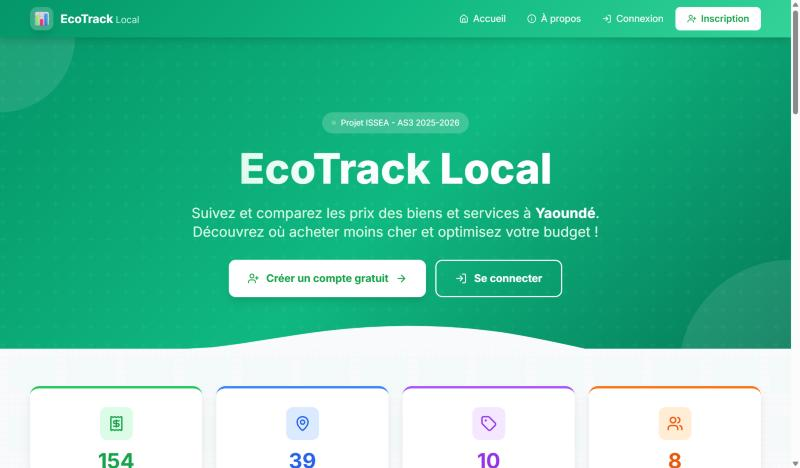

[← Back to projects](/#work){.pf-back}

```{=html}
<ul class="pf-facts">
  <li><span>Topic</span><b>Students' cost of living in Yaoundé</b></li>
  <li><span>Team</span><b>3 students, web programming and databases course, ISSEA</b></li>
  <li><span>Tools</span><b>Python, Django</b></li>
</ul>
<p class="pf-docrow"><a class="pf-more pf-more--solid" href="https://nitiemajoris.pythonanywhere.com/accounts/visite/">Explore as a visitor</a> <a class="pf-more" href="https://nitiemajoris.pythonanywhere.com">Open the app</a></p>
```

## The question

Transport, housing and food prices change fast, and the same product does not cost the same in every neighbourhood. How can students know where to buy cheaper, and how can we collect reliable local price data?

## The idea: participatory data collection

Users record their daily expenses: product, price, place and neighbourhood. Each entry becomes a data point. Together, these entries give a picture of prices across Yaoundé that no single person could collect.

{.pf-shot}

## What the app does

- **Quick entry** of expenses, with predefined products and automatic validation.
- **Interactive dashboard**: charts of expenses by category and by period.
- **Price comparison** between neighbourhoods, to find where a product is cheapest.
- **Interactive map** of expenses in Yaoundé.
- **Anomaly detection**: the app flags likely entry errors and duplicates, which matters when data comes from many users.
- **CSV export** for further analysis in Excel or R.

{.pf-shot}

## What I learned

This project covers the whole chain of a small statistical system: designing the database, collecting data from users, checking its quality, and presenting the results. You can explore it without an account: the visitor mode shows the dashboard, map, comparisons and anomalies in read-only mode, with the collectors' names hidden.
