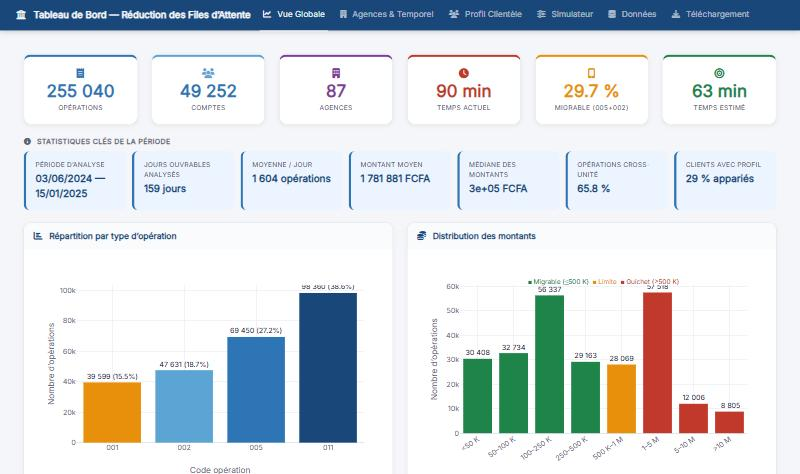
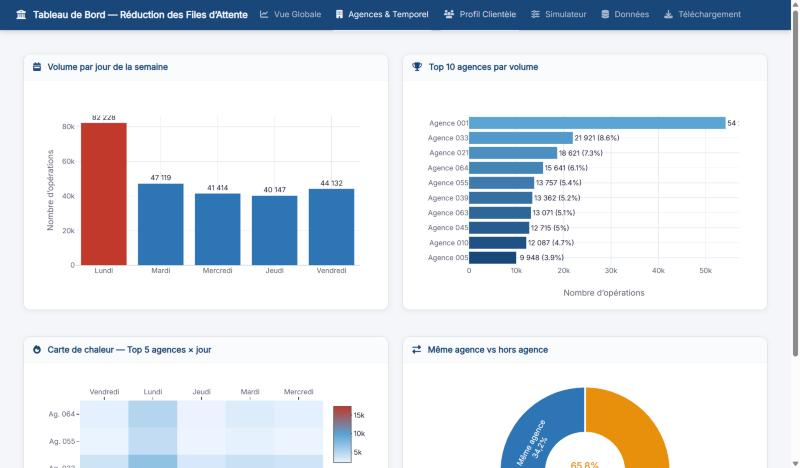
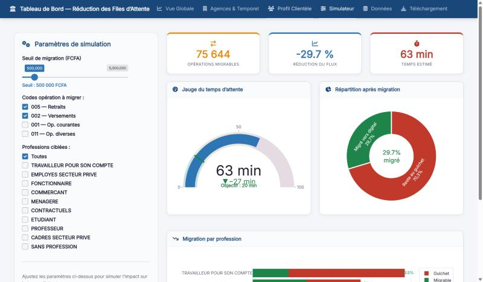

[← Back to projects](/#work){.pf-back}

```{=html}
<ul class="pf-facts">
  <li><span>Data</span><b>255,040 bank operations, 87 branches, June 2024 – January 2025</b></li>
  <li><span>App</span><b>6 tabs, including a scenario simulator</b></li>
  <li><span>Tools</span><b>R, Shiny</b></li>
</ul>
<p class="pf-docrow"><a class="pf-more pf-more--solid" href="https://joris-nitiema.shinyapps.io/dashboard-files-attente/">Open the app</a></p>
```

## The question

Customers of a bank wait a long time at the counter. Which operations fill the queues, when, and how much time could the bank save by moving simple operations to digital channels?

## The data

Real, anonymised operations made at the counters of a bank: 255,040 operations on 49,252 accounts, in 87 branches, over 159 working days (3 June 2024 to 15 January 2025). Each operation has a type, an amount, a date and a branch. About 29% of them are matched to a customer profile (sex, profession, seniority).

## What the dashboard shows

{.pf-shot}

- **Overview.** Volume by type of operation, distribution of amounts, and daily activity with a 5-day moving average.
- **Branches and time.** Mondays are far busier than other days: about 82,000 operations, against 40,000 to 47,000 for each other weekday. One branch alone handles 21% of all operations, and 66% of operations are made outside the customer's home branch.
- **Customer profile.** Who comes to the counter, by sex, profession and seniority, and for what amounts.
- **Data and download.** The filtered data can be explored and exported.

{.pf-shot}

## The simulator

The simulator answers a "what if" question: *what if small, simple operations no longer needed the counter?*

The user chooses an amount threshold, the types of operation to move (withdrawals, deposits…) and the customer groups to target. The app then counts the operations that would leave the counter and estimates the new waiting time.

With the default settings (withdrawals and deposits up to 500,000 FCFA), 75,644 operations could move to digital channels. That is 29.7% of the flow, and the estimated waiting time falls from 90 to 63 minutes.

{.pf-shot}

## What it means, in simple words

A large part of the queue comes from small operations that a phone or an ATM could handle. The dashboard lets a manager see where and when the pressure is highest, and test a migration policy before deciding. In this scenario the estimate stays well above the 20-minute target shown in the app, so digital migration helps but is not enough alone.
