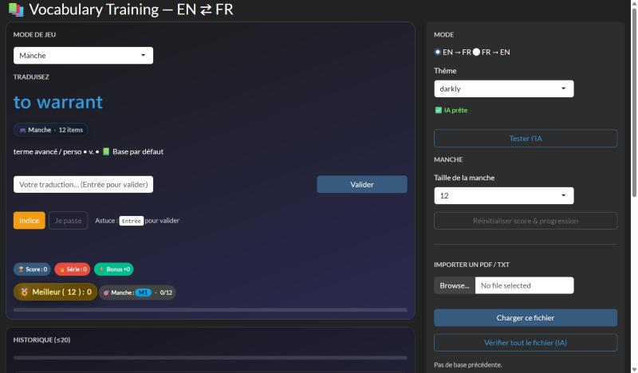

[← Back to projects](/#work){.pf-back}

```{=html}
<ul class="pf-facts">
  <li><span>Goal</span><b>Practise English–French vocabulary (B2–C1)</b></li>
  <li><span>Type</span><b>Personal project</b></li>
  <li><span>Tools</span><b>R, Shiny</b></li>
</ul>
<p class="pf-docrow"><a class="pf-more pf-more--solid" href="https://joris-nitiema.shinyapps.io/application/">Open the app</a></p>
```

## Why I built it

My Master's is taught in English. I wanted a quick way to practise advanced vocabulary every day, with my own word lists, so I built the tool I needed.

{.pf-shot}

## What the app does

- **Three game modes**: a round with a fixed number of words, a race against the clock, and a streak mode where one mistake ends the game.
- **Both directions**: English → French and French → English.
- **Scoring**: one point per correct answer, with a bonus of 25% for every three correct answers in a row.
- **Tolerant correction**: small spelling mistakes and synonyms are accepted, with the help of an AI model.
- **Your own lists**: import a PDF or text file of words, and the app can check the whole file.
- **Progress tracking**: a word counts as mastered after three correct answers, and the app shows the share of the list already covered.

{.pf-shot}
