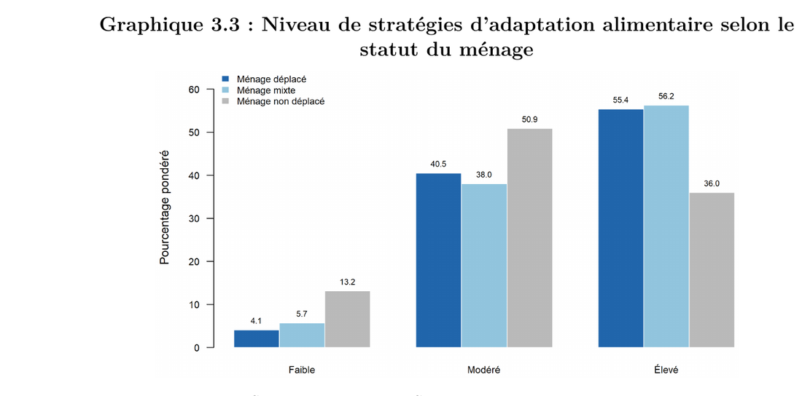
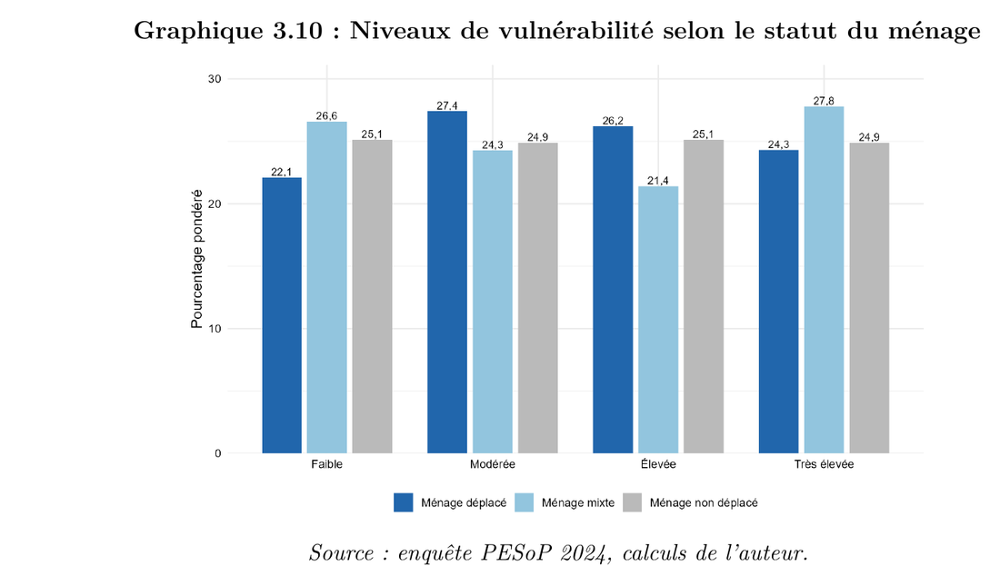

[← Retour aux expériences](/#experience){.pf-back}

```{=html}
<ul class="pf-facts">
  <li><span>Département</span><b>Statistiques démographiques, socio-économiques et environnementales</b></li>
  <li><span>Données</span><b>Enquête PESoP 2024 : 2 686 ménages dans 5 communes</b></li>
  <li><span>Résultat</span><b>Mémoire soutenu le 29 juin 2026, noté 17,20/20</b></li>
</ul>
<p class="pf-docrow">
  <a class="pf-more pf-more--solid" href="/assets/docs/experience/thesis-ins-2026.pdf">Lire le mémoire (PDF)</a>
  <a class="pf-more" href="/assets/docs/experience/ins-internship-certificate.pdf">Attestation de stage</a>
</p>
```

## La question

Dans la région de l'Ouest du Cameroun, le déplacement forcé dure depuis des années. Les familles déplacées vivent dans des communes d'accueil, aux côtés de familles qui n'ont jamais bougé. L'aide cible souvent les seuls ménages déplacés.

Mon mémoire posait la question suivante : **à quel point les ménages de ces communes d'accueil sont-ils vulnérables, sous quelles formes, et qu'est-ce qui l'explique ?** Il porte sur l'ensemble des ménages des cinq communes les plus exposées, déplacés ou non.

## Ce que j'ai fait

- Préparation et description des données de l'enquête PESoP 2024 (enquête de profilage HCR, GIZ, JIPS, INS et BUCREP), avec les pondérations.
- Construction d'un **indice synthétique de vulnérabilité** par Analyse des Correspondances Multiples (ACM), découpé ensuite en quatre niveaux ordonnés.
- **Typologie en cinq profils de ménages** par Classification Ascendante Hiérarchique (CAH, méthode de Ward).
- Identification des **déterminants de la vulnérabilité** par un modèle logit ordonné estimé sous le plan de sondage.
- Rédaction du mémoire et soutenance devant un jury.

Outils : R et Python.

## Principaux résultats

**1. L'alimentation est la dimension où les ménages déplacés sont les plus touchés.** 55,4 % des ménages déplacés ont un niveau élevé de stratégies d'adaptation alimentaire, contre 36,0 % des ménages non déplacés.

{.pf-shot}

**2. Mais la vulnérabilité globale est partagée.** Une fois les privations agrégées dans l'indice, le niveau de vulnérabilité ne diffère pas significativement entre ménages déplacés et non déplacés. Le déplacement modifie la *forme* de la vulnérabilité plus que son *intensité*.

{.pf-shot}

**3. L'instruction est le facteur le plus protecteur.** Quand le chef de ménage a un niveau supérieur, la probabilité d'appartenir à un niveau de vulnérabilité plus élevé baisse de 93 %.

**4. La faiblesse de la documentation civile accroît le risque** de 75 %. La situation matrimoniale et la commune de résidence comptent aussi. L'ancienneté du déplacement n'a pas d'effet significatif.

## Ce que cela signifie

- L'aide gagnerait à cibler les ménages vulnérables, et pas seulement les ménages déplacés : beaucoup de familles d'accueil sont dans la même situation.
- Deux leviers ressortent : l'éducation et la formation, et l'accompagnement pour obtenir les documents d'état civil. L'enquête montre que le premier obstacle n'est pas le coût, mais la méconnaissance des démarches.
- Les besoins varient fortement d'une commune à l'autre : l'action doit être territorialisée.

## Limites

L'indice est relatif : il classe les ménages les uns par rapport aux autres, sans mesurer la privation dans l'absolu. Les données sont transversales : les résultats sont des associations, pas des causalités établies. Ils valent pour ces cinq communes seulement.
