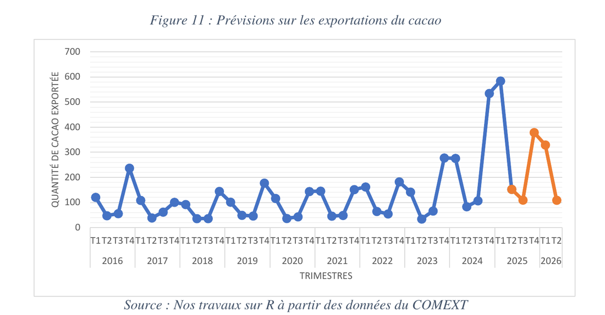

[← Retour aux expériences](/#experience){.pf-back}

```{=html}
<ul class="pf-facts">
  <li><span>Division</span><b>Division de la Prévision, Cellule du suivi et de l'analyse de l'économie réelle</b></li>
  <li><span>Données</span><b>Production et exportations de cacao, 2015 – 2025</b></li>
  <li><span>Livrable</span><b>Rapport de stage soutenu le 27 février 2026</b></li>
</ul>
<p class="pf-docrow">
  <a class="pf-more pf-more--solid" href="/assets/docs/experience/minfi-internship-report-2025.pdf">Lire le rapport (PDF)</a>
  <a class="pf-more" href="/assets/docs/experience/minfi-internship-certificate.pdf">Attestation de stage</a>
</p>
```

## Contexte

Le cacao est un pilier de l'agriculture d'exportation du Cameroun et une source de recettes publiques. La Division de la Prévision suit l'économie réelle et prépare notamment le rapport annuel sur la situation économique (RASIPEFIN) et les notes de conjoncture trimestrielles.

## Ce que j'ai fait

- Lecture et analyse critique de la note de conjoncture du quatrième trimestre 2024 et du RASIPEFIN 2024, sur la forme et sur le fond, pour en améliorer la rédaction.
- Participation à la préparation des correspondances adressées par le ministère aux administrations et aux partenaires (Banque mondiale, FMI, BEAC) pour l'enquête annuelle, et à la collecte de données auprès d'une entreprise publique.
- Construction d'un tableau de bord d'indicateurs agricoles, remplaçant des calculs refaits à la main sous Excel.
- Étude personnelle : **l'évolution de la production et des exportations de cacao au Cameroun entre 2015 et 2025**.

Outils : Excel pour l'analyse descriptive, R pour les prévisions.

## L'étude

**Données.** Le RASIPEFIN et la base du commerce extérieur du ministère.

**Méthode.** Une analyse descriptive de la production, des exportations et des prix, puis une décomposition multiplicative de la série trimestrielle des exportations (tendance × saisonnalité) pour prévoir les trimestres suivants.

**Principaux résultats.**

- La production a oscillé autour de 310 000 tonnes par an sur la période.
- Les volumes exportés ont reculé d'environ 265 000 tonnes en 2015 à environ 180 000 tonnes en 2023, et restent dominés par les fèves brutes.
- Les prix ont été très volatils, de 1 160 FCFA/kg en 2017 à près de 1 780 FCFA/kg en 2023, sans lien significatif avec les volumes produits ou exportés.
- Les exportations sont fortement saisonnières : un pic au quatrième trimestre (campagne principale) et un creux au deuxième. La prévision donnait un pic d'environ 379 milliards de FCFA au quatrième trimestre 2025.

{.pf-shot}

## Ce que cela signifie

Les ventes de cacao à l'étranger suivent le calendrier agricole. Comme ce schéma se répète chaque année, le ministère peut l'anticiper : logistique portuaire et douanière pendant le pic, et prévisions budgétaires tenant compte du creux du deuxième trimestre. L'étude recommande aussi de transformer davantage le cacao sur place, les exportations restant dominées par les fèves brutes.

## Limites

La série trimestrielle est courte (2016–2025), et la méthode suppose une saisonnalité stable, alors que la filière reste exposée aux chocs climatiques et aux cours mondiaux.
