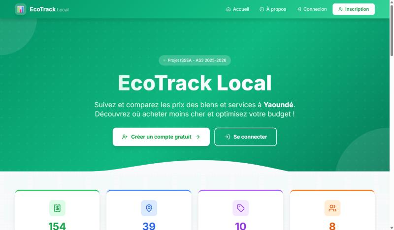
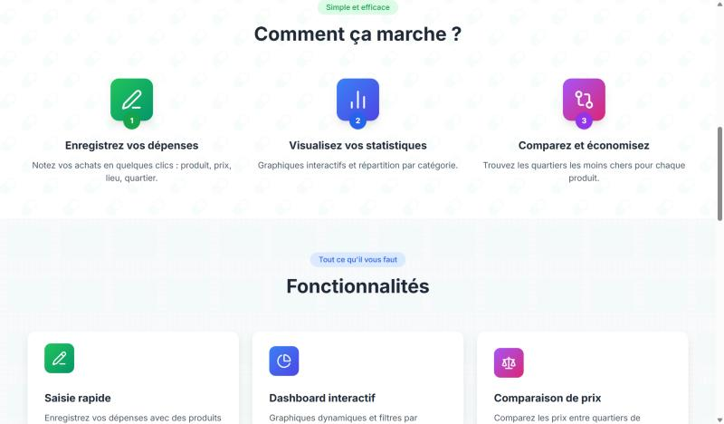

[← Retour aux projets](/#work){.pf-back}

```{=html}
<ul class="pf-facts">
  <li><span>Sujet</span><b>Coût de la vie des étudiants à Yaoundé</b></li>
  <li><span>Équipe</span><b>3 étudiants, cours de programmation web et bases de données, ISSEA</b></li>
  <li><span>Outils</span><b>Python, Django</b></li>
</ul>
<p class="pf-docrow"><a class="pf-more pf-more--solid" href="https://nitiemajoris.pythonanywhere.com">Ouvrir l'application</a></p>
```

## La question

Les prix du transport, du logement et de l'alimentation évoluent vite, et un même produit ne coûte pas le même prix dans tous les quartiers. Comment permettre aux étudiants de savoir où acheter moins cher, et comment collecter des données de prix locales et fiables ?

## L'idée : une collecte participative

Les utilisateurs enregistrent leurs dépenses quotidiennes : produit, prix, lieu, quartier. Chaque saisie devient une donnée. Ensemble, elles donnent une image des prix à Yaoundé qu'une seule personne ne pourrait pas collecter.

{.pf-shot}

## Ce que fait l'application

- **Saisie rapide** des dépenses, avec des produits prédéfinis et une validation automatique.
- **Tableau de bord interactif** : graphiques des dépenses par catégorie et par période.
- **Comparaison des prix** entre quartiers, pour trouver où un produit est le moins cher.
- **Carte interactive** des dépenses à Yaoundé.
- **Détection d'anomalies** : l'application repère les erreurs de saisie probables et les doublons, ce qui compte quand les données viennent de nombreux utilisateurs.
- **Export CSV** pour poursuivre l'analyse sous Excel ou R.

{.pf-shot}

## Ce que j'ai appris

Ce projet couvre toute la chaîne d'un petit système statistique : concevoir la base de données, collecter auprès des utilisateurs, contrôler la qualité, restituer les résultats. Le tableau de bord, la carte et la comparaison nécessitent un compte gratuit.
