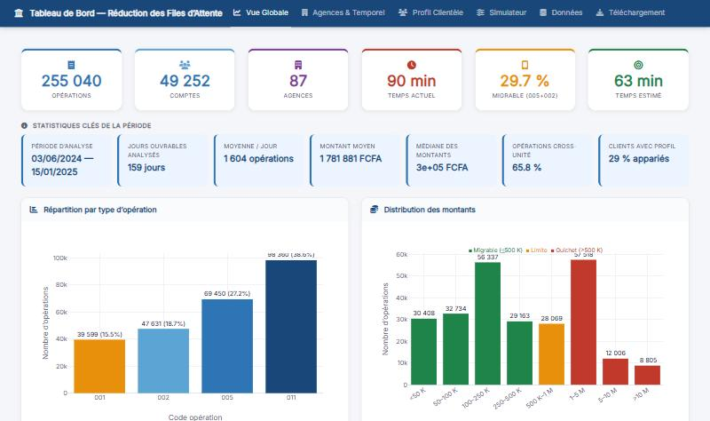
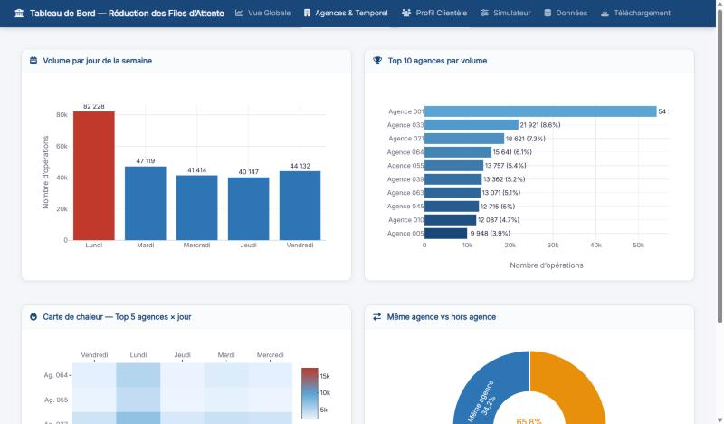
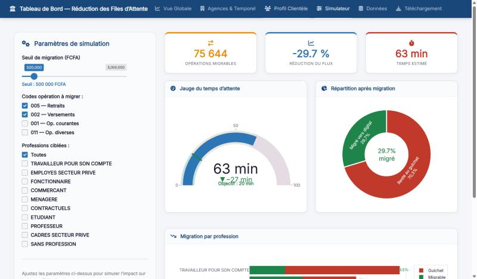

[← Retour aux projets](/#work){.pf-back}

```{=html}
<ul class="pf-facts">
  <li><span>Données</span><b>255 040 opérations bancaires, 87 agences, juin 2024 – janvier 2025</b></li>
  <li><span>Application</span><b>6 onglets, dont un simulateur de scénarios</b></li>
  <li><span>Outils</span><b>R, Shiny</b></li>
</ul>
<p class="pf-docrow"><a class="pf-more pf-more--solid" href="https://joris-nitiema.shinyapps.io/dashboard-files-attente/">Ouvrir l'application</a></p>
```

## La question

Les clients d'une banque attendent longtemps au guichet. Quelles opérations remplissent les files, à quels moments, et combien de temps la banque gagnerait-elle en orientant les opérations simples vers les canaux digitaux ?

## Les données

Des opérations réelles et anonymisées, effectuées aux guichets d'une banque : 255 040 opérations sur 49 252 comptes, dans 87 agences, sur 159 jours ouvrables (du 3 juin 2024 au 15 janvier 2025). Chaque opération a un type, un montant, une date et une agence. Environ 29 % d'entre elles sont appariées à un profil client (sexe, profession, ancienneté).

## Ce que montre le tableau de bord

{.pf-shot}

- **Vue globale.** Volume par type d'opération, distribution des montants, activité quotidienne avec moyenne mobile sur 5 jours.
- **Agences et temporel.** Le lundi est de loin le jour le plus chargé : environ 82 000 opérations, contre 40 000 à 47 000 pour chacun des autres jours. Une seule agence traite 21 % des opérations, et 66 % des opérations sont faites hors de l'agence du client.
- **Profil de la clientèle.** Qui vient au guichet, selon le sexe, la profession et l'ancienneté, et pour quels montants.
- **Données et téléchargement.** Les données filtrées peuvent être explorées et exportées.

{.pf-shot}

## Le simulateur

Le simulateur répond à une question : *et si les petites opérations simples ne passaient plus par le guichet ?*

L'utilisateur choisit un seuil de montant, les types d'opérations à migrer (retraits, versements…) et les profils de clients ciblés. L'application compte alors les opérations qui quitteraient le guichet et estime le nouveau temps d'attente.

Avec les réglages par défaut (retraits et versements jusqu'à 500 000 FCFA), 75 644 opérations pourraient passer au digital. Cela représente 29,7 % du flux, et le temps d'attente estimé passe de 90 à 63 minutes.

{.pf-shot}

## Ce que cela signifie

Une grande partie de la file vient de petites opérations qu'un téléphone ou un distributeur pourrait traiter. Le tableau de bord permet à un responsable de voir où et quand la pression est la plus forte, et de tester une politique de migration avant de décider. Dans ce scénario, l'estimation reste bien au-dessus de l'objectif de 20 minutes affiché dans l'application : la migration digitale aide, mais ne suffit pas seule.
