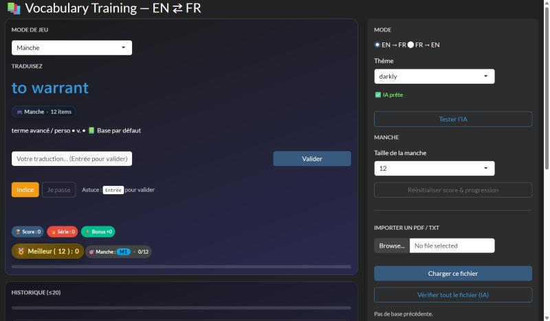

[← Retour aux projets](/#work){.pf-back}

```{=html}
<ul class="pf-facts">
  <li><span>Objectif</span><b>S'entraîner au vocabulaire anglais–français (B2–C1)</b></li>
  <li><span>Type</span><b>Projet personnel</b></li>
  <li><span>Outils</span><b>R, Shiny</b></li>
</ul>
<p class="pf-docrow"><a class="pf-more pf-more--solid" href="https://joris-nitiema.shinyapps.io/application/">Ouvrir l'application</a></p>
```

## Pourquoi je l'ai créée

Mon Master est enseigné en anglais. Je voulais un moyen rapide de pratiquer chaque jour un vocabulaire avancé, avec mes propres listes de mots : j'ai donc construit l'outil dont j'avais besoin.

{.pf-shot}

## Ce que fait l'application

- **Trois modes de jeu** : une manche avec un nombre fixe de mots, une course contre la montre, et un mode série où une erreur arrête la partie.
- **Dans les deux sens** : anglais → français et français → anglais.
- **Score** : un point par bonne réponse, avec un bonus de 25 % toutes les trois bonnes réponses d'affilée.
- **Correction tolérante** : les petites fautes et les synonymes sont acceptés, avec l'aide d'un modèle d'IA.
- **Vos propres listes** : import d'un fichier PDF ou texte, que l'application peut vérifier en entier.
- **Suivi de progression** : un mot est maîtrisé après trois bonnes réponses, et l'application affiche la part de la liste déjà couverte.

{.pf-shot}
